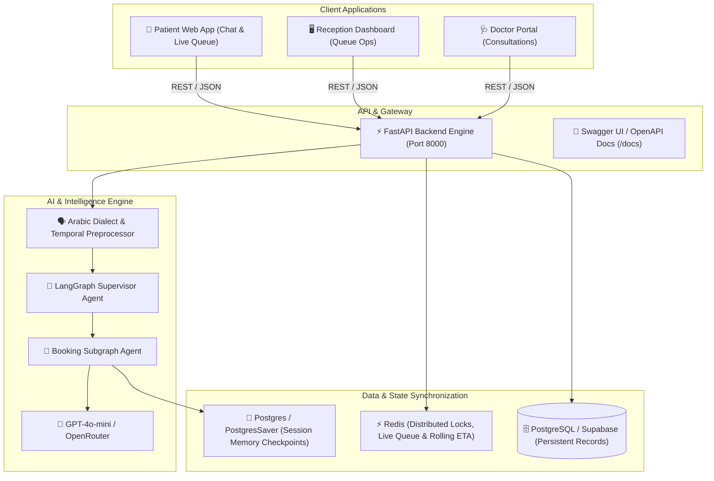

<div align="center">

# 🏥 3eyadaty (عيادتي)
### Enterprise Autonomous AI Clinic Management & Real-Time Queue System

[](https://fastapi.tiangolo.com)
[](https://langchain-ai.github.io/langgraph/)
[](https://python.org)
[](https://redis.io)
[](https://nextjs.org)
[](backend/run_all_tests.py)
[](postman/README.md)
[](LICENSE)

<p align="center">
  <b>Production-grade, resilient clinic management platform featuring autonomous multi-turn LangGraph AI booking agents, Egyptian Arabic dialect NLP, millisecond-level distributed slot locking, and dynamic live queue tracking with rolling average ETA recalculation.</b>
</p>

[Phase 2 Doctor AI Guide (العربية)](docs/PHASE_2_DOCTOR_AI_GUIDE.md) • [Phase 2 Doctor AI Guide (English)](docs/PHASE_2_DOCTOR_AI_GUIDE_EN.md) • [Full Guide (العربية)](docs/FRONTEND_INTEGRATION_GUIDE.md) • [Full Guide (English)](docs/FRONTEND_INTEGRATION_GUIDE_EN.md) • [Postman Collection](postman/README.md) • [Live Swagger Docs](https://3eyadaty-api.up.railway.app/docs)

</div>

---

## 🌟 Key Capabilities & Architectural Highlights

- 🤖 **Autonomous Multi-Turn AI Booking Agent**: Powered by LangGraph supervisor and booking subgraphs with persistent memory (`thread_id`), handling availability inquiries, bookings, rescheduling, and cancellations in natural Egyptian Arabic dialect.
- 🔒 **Distributed Concurrency & Race Condition Defense**: Redis-backed atomic distributed locking guarantees single-winner slot allocation even under heavy simultaneous load (verified under 10+ concurrent coroutines).
- 🗣️ **Egyptian Dialect NLP Engine**: Normalizes spelled-out phone numbers (*"زيرو عشره اتناشر..."* ➔ `01012...`), relative Arabic times (*"حداشر ونص الصبح"*, *"واحدة الضهر"*, *"اربعه العصر"*), and Arabic-Indic numerals.
- ⏱️ **Dynamic Live Queue & Rolling Average ETA**: Real-time queue tracker with automatic rolling-average recalculation upon each completed consultation, providing patients with accurate waiting times.
- 🛡️ **Enterprise Security Guardrails**:
  - **Single Active Booking per Day**: Prevents appointment spamming and slot denial-of-service.
  - **ID Hijacking & Unauthorized Modification Defense**: Restricts cancellations and queries exclusively to verified session owners.
  - **Temporal Integrity Engine**: Automatically rejects past dates and expired hours of today, handles weekly clinic off-days (Friday), and dynamically suggests the next available working day.
- 🧪 **Comprehensive Automated Test Suite**: 39 automated enterprise tests across 4 suites with a **100.0% pass rate**.

---

## 🏛️ System Architecture



---

## 🚀 Quick Start (Local Development)

### 1. Prerequisites
- **Python 3.12+**
- **Node.js 20+**
- **Docker & Docker Compose** (Optional, for full stack containerization)
- **Redis Server** (Local or Upstash)

### 2. Clone and Setup Environment
```bash
git clone https://github.com/Gohar-Hany/Clinics-system.git
cd Clinics-system

# Copy environment template
cp .env.example .env
# Edit .env and configure your OPENROUTER_API_KEY and REDIS_URL
```

### 3. Run Backend (FastAPI + LangGraph)
```bash
cd backend
python -m venv venv

# Windows
.\venv\Scripts\activate

# Linux / macOS
source venv/bin/activate

pip install -r requirements.txt
uvicorn app.main:app --host 0.0.0.0 --port 8000 --reload
```
API will be live at `http://localhost:8000`.  
Explore the interactive Swagger UI at **`http://localhost:8000/docs`**.

### 4. Run Automated Test Suites
Execute all 39 enterprise tests across all 4 suites:
```bash
python backend/run_all_tests.py
```

### 5. Run Frontend (Next.js 16)
```bash
cd frontend
npm install
# point the UI at your local backend
echo NEXT_PUBLIC_API_URL=http://localhost:8000 > .env.local
echo NEXT_PUBLIC_CLINIC_TOKEN=<same value as CLINIC_CONFIG_TOKEN> >> .env.local
npm run dev
```
Frontend runs at `http://localhost:3000`.

| Page | Who | What |
| :--- | :--- | :--- |
| `/` | Patients | Landing: book or track your turn |
| `/chat` | Patients | AI booking chat (Egyptian Arabic / English), slot buttons, booking card |
| `/queue` | Patients | Track your turn by phone or `REF-XXXX`, live waiting-room board |
| `/dashboard` | Staff | KPIs, today's slot timeline, who's inside / waiting, 2-week booking load, recent bookings |
| `/reception` | Staff | Day list, check-in → consultation → done, no-show / cancel, walk-in booking |
| `/doctor` | Staff | SOAP report & Rx from a recording or transcript, imaging analysis, guidelines |

> **No Docker?** The backend falls back to an in-memory store, so data resets when the server restarts.
> Use **Dashboard → "ملء النظام ببيانات تجريبية"** (or `POST /api/v1/appointments/admin/seed-demo`) to fill a realistic demo day.

### Clinic profile
Set these in `backend/.env` — they appear in the UI and the booking agent uses them to answer patients:
`CLINIC_NAME`, `DOCTOR_NAME`, `DOCTOR_SPECIALTY`, `CLINIC_ADDRESS`, `CLINIC_PHONE`, `CONSULTATION_FEE`, `CLINIC_TIMEZONE` (default `Africa/Cairo`).
Anything left empty, the agent says reception will confirm instead of inventing it.

---

## 📡 API Reference Overview

| Endpoint | Method | Purpose | Key Parameters / Payload |
| :--- | :---: | :--- | :--- |
| `/api/v1/chat` | `POST` | AI booking & inquiries | `message`, `clinic_id`, `thread_id`, `patient_phone` → `response`, `data.slots`, `data.booking` |
| `/api/v1/clinic/info` | `GET` | Public clinic profile & hours | — |
| `/api/v1/queue/position/{clinic}/{doc}/{phone\|REF\|id}` | `GET` | Patient queue tracker | status, patients ahead, ETA, day/time |
| `/api/v1/queue/display/{clinic}/{doc}` | `GET` | Public waiting-room board (ticket numbers only) | — |
| `/api/v1/dashboard/overview` 🔒 | `GET` | Dashboard KPIs & charts | `date` |
| `/api/v1/appointments` 🔒 | `GET` | Day list | `date`, `status` |
| `/api/v1/appointments` 🔒 | `POST` | Walk-in booking | `patient_name`, `patient_phone`, `date`, `time`, `notes` |
| `/api/v1/appointments/{id}/status` 🔒 | `POST` | Visit lifecycle | `action`: `check_in` · `start` · `complete` · `no_show` · `cancel` |
| `/api/v1/appointments/slots` | `GET` | Free slots for a day | `date` |
| `/api/v1/appointments/admin/seed-demo` 🔒 | `POST` | Replace all data with a demo day | — |
| `/api/v1/queue/check-in·start·complete·cancel/{id}` 🔒 | `POST` | Legacy reception actions (now map to the lifecycle) | — |
| `/health` | `GET` | Healthcheck | — |

🔒 = requires the `X-Clinic-Token` header.

For full request/response schemas, TypeScript types, and React hooks, see:
- 📖 **[Frontend Integration Guide (Arabic)](docs/FRONTEND_INTEGRATION_GUIDE.md)**
- 📖 **[Frontend Integration Guide (English)](docs/FRONTEND_INTEGRATION_GUIDE_EN.md)**

---

## 🧪 Enterprise Test Audit Report

```text
======================================================================
📊 MASTER SUITE FINAL AUDIT REPORT
======================================================================
  1. Exact User Scenario & Phone Memory Suite        : ✅ PASSED (15.95s)
  2. Concurrency & Slot Isolation Suite              : ✅ PASSED (11.98s)
  3. Enterprise 18-Test Comprehensive Suite          : ✅ PASSED (20.39s)
  4. Production Resilience & Security Suite          : ✅ PASSED (14.18s)
----------------------------------------------------------------------
Total Suites Executed : 4
Passed Suites         : 4
Failed Suites         : 0
Total Execution Time  : 62.50s
======================================================================
```
Suites 1, 3 and 4 talk to the live LLM and expect the backend on `localhost:8000`.

---

## ☁️ Deployment Guide (Railway & Cloud)

### 🚂 Deploying Backend on Railway:
This repository includes a production-ready `Dockerfile` and `railway.json`.

1. Connect your GitHub repository to [Railway](https://railway.com).
2. Set the **Root Directory** to `backend` (or deploy from root using the configured `railway.json`).
3. Add the following **Environment Variables** in Railway:
   - `OPENROUTER_API_KEY`: Your OpenRouter API key
   - `REDIS_URL`: Upstash or Railway Redis connection URL
   - `SYNC_DATABASE_URL`: PostgreSQL connection string (Supabase / Railway Postgres)
   - `PORT`: (Automatically assigned by Railway)
4. Deploy! The healthcheck at `/health` will verify successful startup.

---

## 📂 Project Structure

```
Clinics-system/
├── README.md
├── docs/                            # Integration guides, Phase 2 guides, original plan
├── postman/                         # Postman collections & environments
├── supabase/migrations/             # SQL schema
├── railway.json · Dockerfile        # Railway deployment (backend)
├── docker-compose.yml               # Local full stack (API, worker, Redis, Postgres)
├── backend/
│   ├── run_all_tests.py             # Runs every suite
│   ├── app/
│   │   ├── main.py · config.py
│   │   ├── core/                    # Clinic clock, Arabic NLP, checkpointer, security
│   │   ├── agents/                  # LangGraph supervisor, booking / doctor / imaging agents
│   │   ├── api/v1/                  # chat, queue, appointments, dashboard, doctor
│   │   └── services/                # appointments & lifecycle, Redis, locking, demo data
│   └── tests/                       # suites + tests/scripts (live/HTTP scripts)
└── frontend/src/
    ├── app/(patient)/               # /chat, /queue
    ├── app/(staff)/                 # /dashboard, /reception, /doctor
    ├── components/                  # UI kit, shells, chat markdown, dashboard charts
    ├── lib/                         # formatting, status labels, polling hooks
    └── services/api.ts              # typed API client
```

---

## 📄 License
This project is licensed under the MIT License — see the [LICENSE](LICENSE) file for details.
